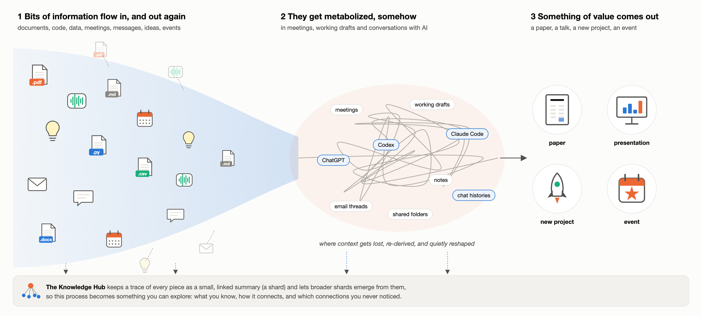
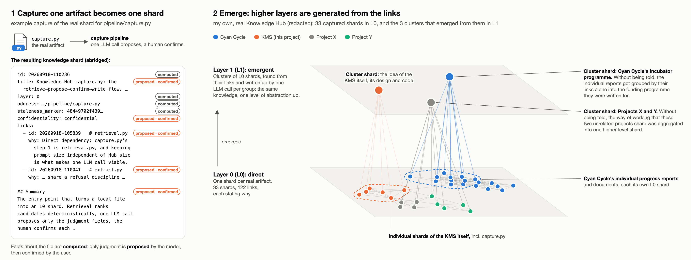
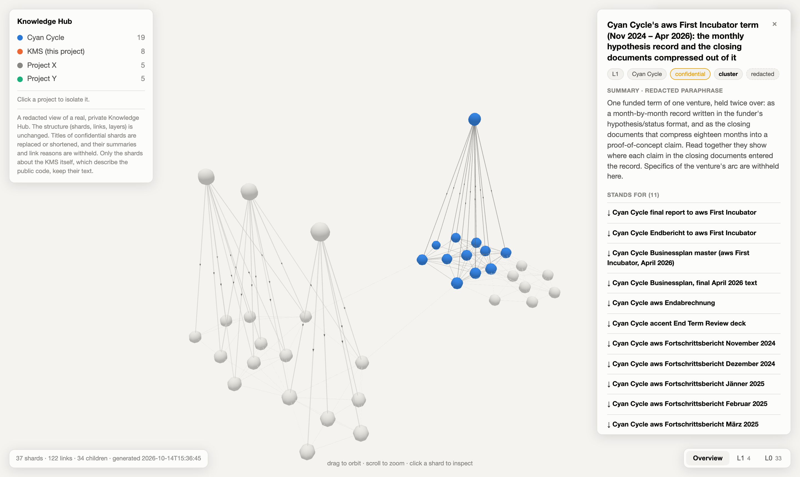

# Knowledge Management System: managing information in the age of LLMs

The modern workplace is overrun with information. Increasingly, we rely on Large Language Models (LLMs) to assist us in whatever we are working on, and LLMs are designed to give convincing and accurate-sounding responses to whatever input they receive. Yet an LLM is only as useful as the context it has about the problem it is asked to address. Anything less than an adequate context yields a confident, eloquent and lightning-fast shot in the dark.

This project introduces a **Knowledge Management System (KMS)** as an attempt to address these difficulties of modern knowledge work. It is a personal prototype with three parts: a **Knowledge Hub (KH)** that keeps a lasting, linked trace of the things I work on; a **Capture Pipeline** that lets the Knowledge Hub absorb new information in a standardized way, as **knowledge shards**; and a **Knowledge Processor** (myself, or an LLM) that lets me surf and explore my accumulated knowledge in new ways.

## Why

Working with LLMs comes with several quiet problems, including:

- **Misalignment has become subtle.** Blatant hallucinations have become rarer. What remains shows up in quieter, irritating ways: answers that are too long, solve a problem nobody asked about, or just feel slightly off.
- **Good context is expensive and fleeting.** Assembling the right context for a task takes effort, and it decays as a project evolves and information piles up.
- **Even curated context drifts.** Carefully kept memory files still wander into unwanted territory or miss angles that matter.

At its core, the KMS explores one question: how can we keep using our knowledge efficiently and flexibly while it keeps accumulating?

To do so, it borrows an idea from complexity science: *combinatorial evolution*, in which existing elements combine into new elements of the same kind, which in turn become building blocks themselves (Arthur, 2026). Language is the classic example. It makes, in Wilhelm von Humboldt's phrase, "infinite use of finite means" (Humboldt, 1836/1988, p. 91, as cited in Arthur, 2026, p. 58). In the Knowledge Hub, a piece of knowledge is a discrete unit, a knowledge shard. Shards link to other shards, and a coherent group of them can itself be represented as one new shard, one level up, built exactly like the shards below it. You can zoom out to broader shards, or break them back down into the concrete ones they stand for. This is also where the KMS loops back to the problems above: because the Knowledge Hub is persistent and lives outside any single LLM session, an LLM can dock into it at whichever shard and layer you choose. Instead of hoping that a model picks up the right context, you decide precisely from which direction, and at which level of abstraction, it approaches a task.

## How it works

1. **Capture.** The Capture Pipeline turns each real artifact (a report, a script, a meeting note) into one knowledge shard: a title, a short summary, links to other shards that each state why they connect, and a pointer back to the original, which is never copied. One LLM call proposes the parts that need judgment; facts about the file (its id, its address, and a marker that detects when it changes) are computed, not guessed. The user can accept or edit each proposal before anything is written.
2. **Link.** Candidates for links are found without an LLM, by text matching, with room reserved for candidates from other projects, so that one large project cannot crowd out connections across projects and flow of ideas across projects is encouraged.
3. **Emerge.** Community detection (Louvain algorithm) finds groups of densely linked shards in Layer 0, and one LLM call per group writes a new shard for each group in Layer 1. The new shard has exactly the same form as the shards it stands for, so the same step can be repeated one layer further up.
4. **Explore.** Start from the top layer and move down only where the broader shards are not enough. Using the Knowledge Hub still gets more expensive as it grows; the aim is that it does so much more slowly than the knowledge itself, because each layer distills the one below. And when it is time to work on a real artifact with an LLM, the path taken through the layers provides a context tailored to the angle from which one approaches it.

**Privacy.** Capture is the only step in which an LLM reads a real artifact, and it can run on a local model so that the artifact never leaves one's own machine (warning: this prototype uses Claude). After capture, the Knowledge Processor works with shards only. A shard contains as much as its owner decides and gives no direct access to the real artifact, such as the actual `.py` or `.csv` file. This encapsulation is meant for playing with one's work at the level of ideas, without handing over the work itself.

## What emerged in my own Knowledge Hub

My own Knowledge Hub holds 33 artifacts from four projects. Most of them are confidential, so the figure above and the [explorable view](explore/redacted_hub.html) are redacted: the structure is real, the contents are withheld. This is what it looks like in the actual viewer, with Cyan Cycle's incubator cluster shard selected:

Two examples:

- **Progress reports grouped into their funding programme.** The monthly progress reports and other documents of my startup Cyan Cycle entered the Knowledge Hub as individual Layer 0 shards. Without being told, the KMS grouped reports and documents from across the programme, by their links alone, into one Layer 1 cluster shard for the incubator programme they were written for.
- **Common ground across unrelated projects.** A university/research project (Project X) and a personal side project (Project Y) share no subject matter, but both used the same kind of tailored memory-file management when working with AI. Without being told, the KMS aggregated these common design elements into one higher-abstraction cluster shard in Layer 1.

These are observations on a small Knowledge Hub, not results.

## Why it matters

- **Working with AI.** Instead of rebuilding context in every session, an LLM can read from a persistent and inspectable Knowledge Hub. The model becomes a swappable tool, while the knowledge stays.
- **Finding new angles.** In my own Knowledge Hub, the most interesting links connect projects that share no subject matter, only a way of working/thinking. These are exactly the kind of connections that are valuable but easy to miss when working within project silos.
- **Engaging with other people's knowledge.** The real artifacts may be shared and external, while their representations are personal. Two people's Knowledge Hubs can therefore point at the same documents while understanding them differently, and comparing them could reveal where two coworkers see the same project differently. It would also let me engage with a colleague's view on a topic when we cannot meet in person for a while. This is meant to complement conversations between people, not to replace them. (Not built yet since I only have one (my own) Knowledge Hub.)
- **Sensitive work.** Every shard carries a confidentiality level, and a higher-level shard inherits the most restrictive level among the shards it stands for. A broad summary therefore cannot leak what its parts keep confidential, and the Knowledge Hub can hold a map of confidential work without holding the work itself.

## Status: a prototype, built from the bottom up

I built the KMS from scratch, starting from first principles, so that my understanding of how it should work would not be shaped by what existing products happen to do. Building it myself was how I worked out what I want it to be. Now that I know, I can make much better decisions about which existing tools to use for which part. What is in this repository is for playing with the idea and the design rather than a polished implementation. Not built yet: opening the original artifacts from the Knowledge Hub, refreshing shards whose originals changed, links between shards in Layer 1, and layers above it.

Many of the KMS's parts or similar underlying ideas exist elsewhere, and the next step is to iterate on the design by integrating them: the **Zettelkasten** (linked notes with stated reasons), **Building a Second Brain** and its PARA method, **Obsidian** and **Logseq** (linked Markdown notes with a graph view), **NotebookLM** (an AI over your own sources), **Microsoft GraphRAG** and **RAPTOR** (clustering text and summarizing the clusters with an LLM at several levels, the closest relatives of the layer generation here), and **MarkItDown** or **Docling** (turning PDF and Word files into text an LLM can read).

## In this repository

- **[`explore/redacted_hub.html`](explore/redacted_hub.html)**: my own Knowledge Hub, redacted. Download it and open it in a browser to orbit the layers and click on shards (it loads its 3D library from the internet).
- **[`founding_design.md`](founding_design.md)**: the design, written before the first line of code.
- **[`pipeline/`](pipeline/)**: capture (`capture.py`), link retrieval (`retrieval.py`), community detection (`community.py`), layer generation (`synthesize.py`) and the graph view (`build_graph.py`).

## Reference

Arthur, W. B. (2026). Combinatorial evolution. In R. M. del Rio-Chanona, M. Pangallo, J. Bednar, E. D. Beinhocker, J. Kaszowska-Mojsa, F. Lafond, P. Mealy, A. Pichler, & J. D. Farmer (Eds.), *The economy as an evolving complex system IV* (Vol. 1, pp. 56–78). SFI Press. https://doi.org/10.37911/9781947864665.03
